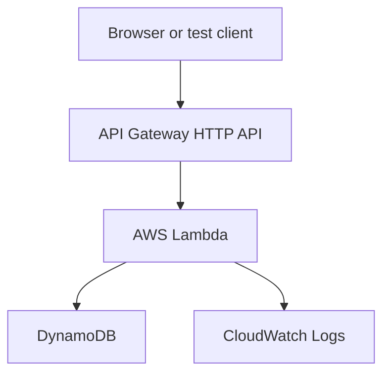
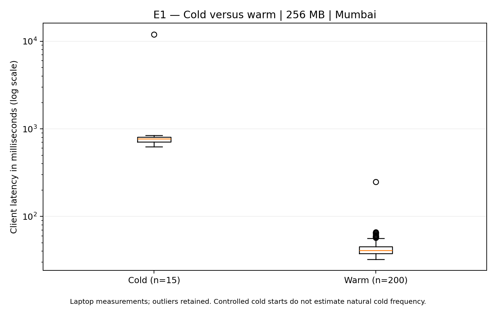
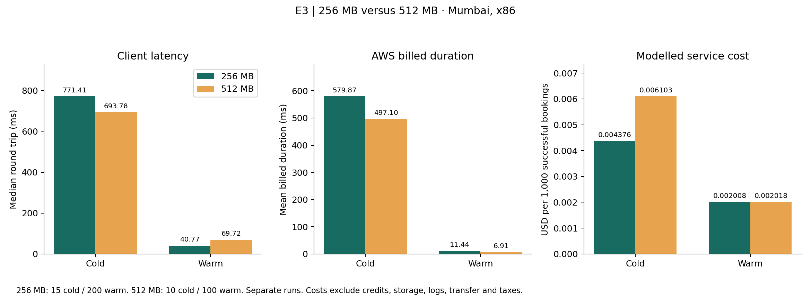
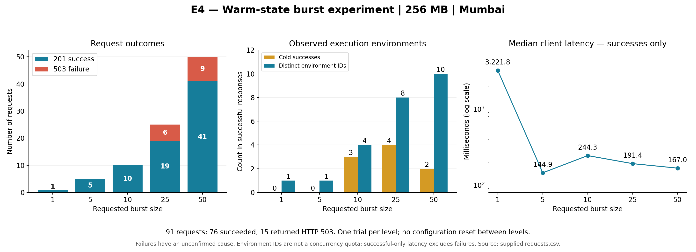
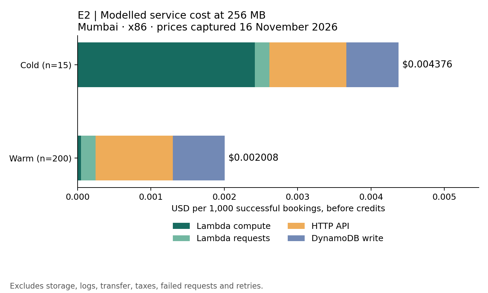
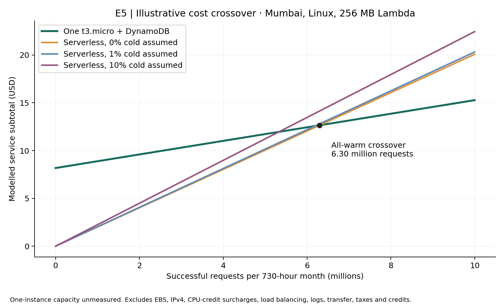

# CareSlot — Practo on AWS

**IT457 Cloud Computing · Group 18 · Dhirubhai Ambani University · Autumn 2026**

CareSlot is a small serverless appointment-booking application built for our Practo on AWS case-study project. We used it to study duplicate-booking prevention, cold starts, memory configuration, burst traffic and service costs.

**[Open the live application](https://tmzmkc53cc.execute-api.ap-south-1.amazonaws.com)**

The assigned case study describes Practo connecting 60 million patients to 200,000 doctors across 10,000 hospitals. Our application implements a single booking component inspired by that study; it does not reproduce Practo’s production system.

## What the application does

- Accepts a synthetic patient alias, doctor ID and appointment slot.
- Validates that the slot is in the future, includes a timezone and falls on a half-hour boundary.
- Converts the slot to UTC so equivalent timezone representations produce the same booking key.
- Creates a booking only if that doctor-slot has not already been claimed.
- Returns timing information and request IDs for experimental analysis.

To try it, submit a booking for an unused future slot. The first request should return **201 Created**. Submitting the same doctor and slot again should return **409 Conflict**, preserving the original booking. Doctors and patients in the demonstration are fictional.

## Architecture



CloudFormation creates the resources and their permissions. The same Lambda function serves the HTML page and handles booking requests.

| Component | Configuration |
|---|---|
| Region | Mumbai, `ap-south-1` |
| CloudFormation stack | `it457-practo` |
| Lambda function | `it457-practo-booking` |
| Runtime | Python 3.12, x86_64 |
| Memory | 256 MB baseline; 512 MB for comparison |
| Timeout | 10 seconds |
| DynamoDB | On-demand capacity; `slot_key` partition key |
| CloudWatch | Seven-day log retention |

### API routes

| Route | Purpose |
|---|---|
| `GET /` | Booking interface |
| `POST /book` | Validate and create a booking |
| `GET /health` | Function-health check; does not test the database |

A booking key combines the doctor ID and normalized UTC slot. DynamoDB `PutItem` uses `attribute_not_exists(slot_key)` to check and write atomically. This avoids the race in a separate read-before-write check.

Invalid input returns 400. An existing booking returns 409. A service failure must be investigated separately; it is not the expected response to a duplicate booking.

## Experiments and results

Measurements were collected on **16 November 2026** from a laptop against the Mumbai deployment. Client records were matched to CloudWatch REPORT records using request IDs.

| Experiment | Work completed | Main result |
|---|---|---|
| E0 — Correctness | Sequential duplicate checks and a five-request same-slot race in each memory run | Each race produced one 201 and four 409 responses |
| E1 — Cold versus warm | 15 cold and 200 warm samples at 256 MB | Median client latency: **771.41 ms cold**, **40.77 ms warm** |
| E2 — Cost per 1,000 | Measured billed durations combined with Mumbai prices | **$0.00437612 all-cold**, **$0.00200767 all-warm** |
| E3 — Memory comparison | 256 MB versus 512 MB; 10 cold and 100 warm samples at 512 MB | Billed duration decreased, but modelled service cost increased |
| E4 — Burst behaviour | One warm-state burst at each level: 1, 5, 10, 25 and 50 | **76 successes and 15 HTTP 503 responses** across 91 requests |
| E5 — Always-on comparison | Simplified Linux t3.micro pricing model | All-warm crossover near **6.30 million requests per 730-hour month** |

E1, E3 and E4 are measurements of the deployed application. E2 and E5 are calculations. **No EC2 instance was launched or benchmarked.** The project stopped at E5.

### Cold and warm latency



The cold median was about 18.92 times the warm median. Median initialization duration was 455.71 ms. One cold request took 11,987.82 ms at the client, while its matched initialization and execution durations were much shorter. We retained this observation; the available data does not identify the source of the additional delay.

### Memory comparison



| Memory | Sample | Count | Median client latency | Mean billed duration | Cost per 1,000 successes |
|---|---|---:|---:|---:|---:|
| 256 MB | Cold | 15 | 771.41 ms | 579.87 ms | $0.00437612 |
| 256 MB | Warm | 200 | 40.77 ms | 11.44 ms | $0.00200767 |
| 512 MB | Cold | 10 | 693.78 ms | 497.10 ms | $0.00610251 |
| 512 MB | Warm | 100 | 69.72 ms | 6.91 ms | $0.00201758 |

At 512 MB, cold client median improved by about 10.1%. However, the reduction in billed duration did not offset the doubled memory factor. The modelled subtotal increased by about 39.5% for cold bookings and 0.5% for warm bookings. The two configurations ran separately, so the higher warm client latency cannot be attributed to memory alone. Of the two tested settings, 256 MB was the lower-cost choice.

### Burst behaviour



| Requested burst size | Successful requests | HTTP 503 responses |
|---|---:|---:|
| 1 | 1 | 0 |
| 5 | 5 | 0 |
| 10 | 10 | 0 |
| 25 | 19 | 6 |
| 50 | 41 | 9 |

Bursts followed the warm sequence without a configuration reset between levels. The cause of the 503 responses remains unconfirmed. Distinct environment IDs do not establish a concurrency quota, and the latency graph includes successful requests only.

### Cost analysis



The calculations use mean CloudWatch **billed duration**, not client latency. Initialization is already included in the billed duration used here.

```text
Lambda compute cost = requests × memory in GB × mean billed seconds × GB-second rate
Service subtotal = Lambda compute + Lambda requests + HTTP API + DynamoDB writes
```

Mumbai rates captured on 16 November 2026:

| Service | Rate used |
|---|---:|
| Lambda x86 compute | $0.0000166667 per GB-second |
| Lambda requests | $0.20 per million |
| HTTP API | $1.05 per million |
| DynamoDB standard writes | $0.71 per million write units |
| Linux t3.micro | $0.0112 per hour |

The successful-booking model assumes one standard DynamoDB write of at most 1 KB and one HTTP API billing increment per call. It excludes storage, logs, transfer, taxes, failed/conflicting requests and retries. Credits and free allowances are not applied. These are service-cost estimates, not the final AWS invoice.



For `N` successful bookings in a 730-hour month:

```text
All-warm serverless = N × $0.000002007666762
EC2 + DynamoDB     = $8.176 + N × $0.00000071
```

The common DynamoDB term cancels when solving for the crossover, giving approximately 6,300,539 bookings. The EC2 scenario assumes direct application serving. Its capacity, EBS, public IPv4, CPU-credit surcharges, load balancing, availability and operational costs were not measured. The crossover therefore does not establish that one t3.micro would meet the workload’s performance requirements.

## Repository structure

```text
README.md
contributions.md
requirements.txt
app/
  index.py                         Lambda handler
  page.html                        Booking interface
infra/
  template.json                    Deployable CloudFormation template
docs/
  week-1/IT457_Week1_Group18.pdf     Case-study report
  week-2/IT457_Week2_Group18.pdf     Architecture and experiment plan
  week-3/IT457_Week3_Group18.pdf     Implementation, results and analysis
results/
  baseline-256mb/                   Requests and CloudWatch CSVs
  comparison-512mb/                 Requests and CloudWatch CSVs
  E2-baseline/                     Cost summary, JSON and graph
  E3-comparison/                   Memory comparison summary, JSON and graph
  E5-model/                        Pricing-model summary, JSON and graph
  figures/                         E1–E5 graphs used in this README
```

## Reports and recorded data

| Document | Contents |
|---|---|
| [Week 1 report](docs/week-1/IT457_Week1_Group18.pdf) | Practo case-study research |
| [Week 2 report](docs/week-2/IT457_Week2_Group18.pdf) | Architecture and proposed experiments |
| [Week 3 report](docs/week-3/IT457_Week3_Group18.pdf) | Deployed application, completed experiments and conclusions |
| [Contributions](contributions.md) | Responsibilities across the three weeks |

The completed scope is documented in Week 3; earlier reports describe the research and plans that led to it.

- **256 MB inputs:** [request records](results/baseline-256mb/requests.csv) and [CloudWatch export](results/baseline-256mb/cloudwatch.csv).
- **512 MB inputs:** [request records](results/comparison-512mb/requests.csv) and [CloudWatch export](results/comparison-512mb/cloudwatch.csv).
- **Derived outputs:** [E2](results/E2-baseline/E2-results.md), [E3](results/E3-comparison/E3-results.md), and [E5](results/E5-model/E5-results.md).

Match request records to CloudWatch rows using the request ID. Keep correctness checks, warmup requests and bursts separate from cold/warm latency samples. The CSVs retain failures and outliers.

The repository currently contains the application, deployment template, recorded data and derived results. Experiment runners and automated analysis/test scripts are not included in this revision. The published figures can be reviewed directly, and the cost calculations are described in the summaries and Week 3 report.

## Deploy a copy

The existing live application can be used directly. To deploy another copy, use the self-contained [CloudFormation template](infra/template.json).

1. Open the AWS CloudFormation console in **Mumbai (`ap-south-1`)**.
2. Create a stack with new resources and upload `infra/template.json`.
3. Choose an unused stack name and leave `MemoryMB` at **256**.
4. Review the resources and acknowledge IAM resource creation.
5. Create the stack and wait for **`CREATE_COMPLETE`**.
6. Open **Outputs** for `ApiUrl`, `FunctionName`, `TableName` and `LogGroup`.
7. Open the returned `ApiUrl`. Submit an unused future doctor-slot booking, then repeat it to check **201 followed by 409**.

The template contains the application code inline, so this deployment does not require a separate Lambda ZIP or a local build script. Its handler is `index.lambda_handler`. The standalone files in `app/` are provided for source review; editing them alone does not update the inline template or deployed function.

For an existing deployment, review a CloudFormation stack update instead of creating a duplicate. The Lambda execution role permits `PutItem` on the project table and required log writes. Administrator deployment permissions are separate.

## Inspect the project locally

```sh
git clone https://github.com/Tirthgandhi05/Practo-IT457.git
cd Practo-IT457
```

Open the reports, CSVs and figures directly. For Python-based inspection, use Python 3.12 and install the listed dependencies in a virtual environment:

```sh
python -m venv .venv
```

On Windows PowerShell:

```powershell
.\.venv\Scripts\python.exe -m pip install -r requirements.txt
```

On macOS or Linux:

```sh
.venv/bin/python -m pip install -r requirements.txt
```

Installing dependencies does not deploy resources or run an experiment. The Lambda handler expects an AWS event, execution context and `TABLE_NAME`; it is not a standalone local web server.

## Measurement notes

Cold samples were collected by changing only `COLD_MARKER` in the Lambda console, waiting for the update to finish, and then sending one measured request from the laptop. The returned cold-start flag was checked. Warm samples followed a separate warmup request, which was excluded from the statistics.

Opening the UI or calling `/health` also invokes Lambda and can consume a cold invocation. Avoid other requests during controlled cold sampling. Preserve `TABLE_NAME` when editing environment variables. After experiments, restore the intended baseline memory and `COLD_MARKER=initial`; manual configuration changes can cause CloudFormation drift.

`client_ms` measures the round trip observed by the laptop. `handler_ms` measures work inside the handler. CloudWatch initialization, execution and billed duration describe different server-side intervals. Use billed duration for compute costs, not client latency.


## Limits of the work

The cold samples were induced by configuration updates and do not estimate the natural cold-start rate. Memory runs used small, unequal samples collected separately. Each burst level was tested once. Client latency includes delays outside Lambda, so it should not be treated as execution time or used to calculate compute charges.

CareSlot has no user authentication, cancellation, doctor-directory verification or complete retry-idempotency mechanism. A lost success response followed by a retry can return 409. Only synthetic data should be used. No production availability or healthcare-compliance claim is made.

Do not commit credentials, access tokens or private keys. Keep the stack available for evaluation. Before later deleting it, preserve required evidence and booking data: the template does not retain the DynamoDB table on stack deletion.

## Team

| Student ID | Name |
|---|---|
| 202301413 | Tirth K Gandhi |
| 202301037 | Bhavya Boda |
| 202301016 | Tirth N Gandhi |

All three members researched the Practo sources, planned the work and jointly prepared the Week 3 report.

| Member | Responsibilities |
|---|---|
| Tirth K Gandhi | Week 2 report and detailed architecture; shared Week 3 cost monitoring and result analysis |
| Bhavya Boda | Experiment planning; shared Week 3 cost monitoring and result analysis |
| Tirth N Gandhi | AWS infrastructure initialization, experiment feasibility and architecture support; Week 3 AWS implementation and configuration |

The weekly breakdown is recorded in [contributions.md](contributions.md).

**Course instructor:** P S Kalyan Sasidhar  
**Institution:** Dhirubhai Ambani University, formerly DA-IICT

## Further reading

- [E2 cost calculation](results/E2-baseline/E2-results.md)
- [E3 memory comparison](results/E3-comparison/E3-results.md)
- [API Gateway pricing](https://aws.amazon.com/api-gateway/pricing/)
- [DynamoDB pricing](https://aws.amazon.com/dynamodb/pricing/on-demand/)
- [EC2 pricing](https://aws.amazon.com/ec2/pricing/on-demand/)
- [E5 pricing model](results/E5-model/E5-results.md)
- [Practo — Scaling Microservices with Kubernetes on AWS](https://youtu.be/YgABcxC4pwQ)
- [DynamoDB condition expressions](https://docs.aws.amazon.com/amazondynamodb/latest/developerguide/Expressions.ConditionExpressions.html)
- [Lambda INIT billing](https://aws.amazon.com/blogs/compute/aws-lambda-standardizes-billing-for-init-phase/)
- [Lambda pricing](https://aws.amazon.com/lambda/pricing/)